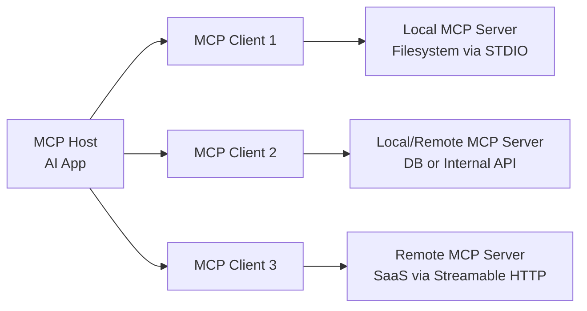

# MCP로 다시 읽는 AI 프레임워크

## 도입

요즘 AI 생태계는 하루가 다르게 새 이름을 쏟아냅니다. 에이전트 프레임워크, 툴 호출, 멀티모달 오케스트레이션, 추론 체인, 메모리 계층까지. 문제는 기술이 너무 빠르게 늘어나면서, 많은 개발자가 이렇게 느낀다는 점입니다.

- 일단 돌아가게는 만들었는데, 왜 이렇게 구성해야 하는지 설명하기 어렵다
- 프레임워크를 갈아타면 설계가 통째로 흔들린다
- API 사용법은 익혔는데, 시스템 경계와 책임은 더 모호해졌다

이 지점에서 MCP(Model Context Protocol)는 꽤 중요한 신호입니다.  
MCP는 단순히 새로운 AI 기능이 아니라, **AI 애플리케이션이 외부 세계와 상호작용하는 방식을 표준화하려는 아키텍처적 시도**입니다.

핵심 화두는 이것입니다.

> MCP는 “AI가 똑똑해지는 방법”이 아니라 **AI 시스템이 안정적으로 확장되는 방법**에 대한 제안이다.

즉, 이건 모델의 문제가 아니라 **시스템 설계의 문제**입니다. 그리고 이 장면, 백엔드 개발자에게는 아주 익숙합니다.  
새로운 패러다임처럼 보이지만, 실은 우리가 오랫동안 다뤄온 문제의 **재림**입니다.

## 본론 1: MCP 구조를 아키텍처로 해부하기

### MCP의 기본 구도: Host-Client-Server 3계층

공식 문서 관점에서 MCP 참여자는 2개가 아니라 3개입니다.

- **MCP Host**: Claude Desktop, VS Code 같은 AI 애플리케이션
- **MCP Client**: Host 내부에서 서버별로 생성되는 연결 담당 컴포넌트
- **MCP Server**: 컨텍스트(데이터/도구/프롬프트)를 제공하는 프로그램

핵심은 **Host와 Client를 분리해서 이해**하는 것입니다. Host는 오케스트레이션을 담당하고, Client는 특정 서버와의 세션을 전담합니다. 즉, Host 1개가 Server N개와 붙을 때, 내부적으로는 Client N개가 생기는 구조입니다.

이 구분은 운영에서 매우 중요합니다.

- 서버 장애 격리 단위를 Client 세션 기준으로 분리할 수 있다
- 서버별 권한/토큰/레이트 정책을 독립 적용할 수 있다
- 특정 서버 재연결이 전체 Host 중단으로 번지는 것을 막을 수 있다

중요한 점은, Host가 각 도구의 사소한 차이를 직접 처리하지 않는다는 것입니다.  
Host는 “이런 기능이 필요하다”를 선언하고, Client는 해당 서버와 프로토콜 대화를 수행하며, Server는 정해진 계약으로 응답합니다.

이 구조는 곧 다음 의미를 가집니다.

- 모델 교체와 도구 교체의 결합도를 낮춘다
- 기능 확장을 할 때 Host 코어를 크게 건드리지 않는다
- 운영 정책(권한, 감사, 제한)을 서버 또는 게이트웨이 접점에 집중시킬 수 있다

### MCP는 2개 레이어로 본다: Data Layer + Transport Layer

공식 아키텍처는 MCP를 다음 두 레이어로 설명합니다.

- **Data Layer(내부 레이어)**: JSON-RPC 2.0 메시지 구조/의미, 라이프사이클, 프리미티브
- **Transport Layer(외부 레이어)**: 실제 연결 방식, 메시지 프레이밍, 인증

이걸 백엔드 감각으로 바꾸면 쉽습니다.

- **Data Layer**는 "무슨 API를 어떤 의미로 주고받는가"에 대한 계약
- **Transport Layer**는 "그 API를 어떤 채널로 안전하게 전달하는가"에 대한 인프라

즉, REST API 설계에서 "리소스 모델"과 "네트워크 경로/인증"를 분리하듯, MCP도 의미 계층과 전달 계층을 분리합니다.

### 화려한 AI가 아니라, 사실은 Json-RPC 계약

많은 사람이 MCP를 들으면 복잡한 AI 런타임을 먼저 떠올립니다. 하지만 기술적 본체는 의외로 담백합니다.

- 요청/응답 기반의 명시적 인터페이스
- 메서드, 파라미터, 결과, 에러 구조의 규격화
- 상태 전이와 예외를 메시지 프로토콜로 표현

즉, MCP는 본질적으로 **JSON-RPC 2.0 기반의 표준 통신 계약**입니다. 이 말은 곧 진입장벽을 크게 낮춥니다.

- “AI 전용 마법”이 아니라 우리가 익숙한 네트워크 프로토콜 설계 문제다
- 잘 정의된 스키마, 타임아웃, 재시도, 에러 코드가 품질을 좌우한다
- 결국 운영 가능한 인터페이스를 설계하는 역량이 핵심이다

공식 예시 플로우도 아주 정석적입니다.

1. `initialize`: 프로토콜 버전/기능 협상
2. `notifications/initialized`: 클라이언트 준비 완료 통지
3. `tools/list`, `resources/list`, `prompts/list`: 기능 탐색
4. `tools/call` 또는 리소스 조회: 실제 실행/조회
5. `notifications/*`: 서버 상태 변화의 실시간 동기화

이 순서는 결국 API 부트스트랩과 동일합니다. 초기 핸드셰이크로 합의하고, Capability 기반으로 안전하게 기능을 호출하며, Notification으로 캐시를 동기화합니다.

### MCP Architecture에서 반드시 알아야 할 Primitive 전체 지도

공식 문서에서 가장 중요한 파트는 프리미티브(Primitives)입니다. "무엇을 주고받을 수 있는가"를 정의하기 때문입니다.

#### 서버가 제공하는 3대 Primitive

- **Tools**: 실행 가능한 함수. (예: 파일 수정, API 호출, DB 질의)
- **Resources**: 읽기 중심 컨텍스트. (예: 파일 내용, 스키마, 조회 결과)
- **Prompts**: 재사용 가능한 상호작용 템플릿

#### 클라이언트가 제공하는 Primitive

- **Sampling**: 서버가 Host의 LLM 추론을 요청 (`sampling/createMessage`)
- **Elicitation**: 서버가 사용자 추가 입력/확인을 요청 (`elicitation/create`)
- **Logging**: 서버가 클라이언트로 로그 전송

#### 크로스커팅 유틸리티

- **Notifications**: 무응답 이벤트 푸시 (예: `notifications/tools/list_changed`)
- **Progress Tracking**: 장시간 작업 진행상태 추적
- **Tasks(Experimental)**: 지연 완료/상태 조회가 필요한 Durable 실행 래퍼

이 구성을 한 문장으로 정리하면 다음과 같습니다.

> Tools는 "행동"이고, Resources는 "맥락"이며, Prompts는 "전략"이다.  
> Sampling/Elicitation은 인간-모델-서버의 루프를 완성하고, Notifications/Progress/Tasks는 운영성을 완성한다.

### 전송(Transport) 기술의 본질: STDIO vs Streamable HTTP

MCP 공식 문서는 두 가지 전송 방식을 중심으로 설명합니다.

- **STDIO Transport**: 로컬 프로세스 간 표준 입출력 통신
- **Streamable HTTP Transport**: 원격 통신(POST 기반, 필요 시 SSE 스트리밍)

실무에서의 선택 기준은 명확합니다.

- 로컬 IDE 플러그인/에이전트 확장: STDIO가 단순하고 빠르다
- 팀 공유 도구/사내 플랫폼 연동: Streamable HTTP가 운영과 확장에 유리하다

원격 환경에서는 인증이 핵심이며, 공식 문서도 표준 HTTP 인증(토큰/키/헤더)과 OAuth 기반 토큰 획득을 권장합니다.

여기서 기술의 본질은 "LLM 연결"이 아니라 **신뢰 경계(Trust Boundary) 설계**입니다. 로컬 서버는 OS 권한 경계에, 원격 서버는 네트워크/인증 경계에 서 있습니다.

요약하면, MCP의 첫인상은 AI지만 실제 난이도 곡선은 **분산 시스템 인터페이스 설계**에 가깝습니다.

---

## 본론 2: 아키텍처 관점에서 본 AI 프레임워크의 기술적 본질

이제 핵심입니다. MCP를 통해 보이는 AI 프레임워크의 본질은 크게 세 축으로 정리됩니다.

## 1) 프로토콜 표준화: 파편화를 추상화 계층으로 흡수한다

AI 앱이 연결해야 할 대상은 제각각입니다.

- SaaS API는 인증 방식이 다르고
- 사내 시스템은 포맷과 제약이 다르며
- 데이터 소스는 지연시간과 장애 패턴이 다릅니다

프레임워크를 직접 붙일수록 Host는 조건문과 예외처리로 비대해집니다. MCP는 이 문제를 **프로토콜 표준화 계층**으로 해결합니다.

### 백엔드 비유 1: JDBC 드라이버 모델

JDBC가 없던 시절을 상상해보면, 애플리케이션은 DB 벤더별 API를 직접 알았어야 합니다.  
JDBC가 등장하면서 우리는 “Driver를 갈아 끼워도 애플리케이션 코어는 유지”할 수 있게 됐습니다.

MCP도 동일한 철학입니다.

- Host는 MCP 계약만 안다
- 실제 구현 차이는 Server가 흡수한다
- 신규 도구 추가는 Host 수정이 아닌 Server 등록으로 수렴한다

공식 Architecture 관점에서 보면 이 표준화는 더 정밀합니다.

- `*/list`로 동적 Discovery를 수행한다
- Discovery 결과의 메타데이터(`name`, `description`, `inputSchema`)를 계약으로 쓴다
- 호출은 계약 기반(`tools/call`)으로만 진행한다

즉, 컴파일 타임 결합이 아니라 **런타임 Capability 협상 + 스키마 기반 호출**로 파편화를 흡수합니다.

여기서 자연스럽게 **OCP(개방-폐쇄 원칙)** 가 살아납니다.

- 확장에는 열려 있고
- 핵심 로직 수정에는 닫혀 있는 구조

AI 프레임워크의 경쟁력은 모델 성능 이전에, 이런 **변화 내성(Resilience to Change)** 을 얼마나 잘 설계했느냐에서 갈립니다.
