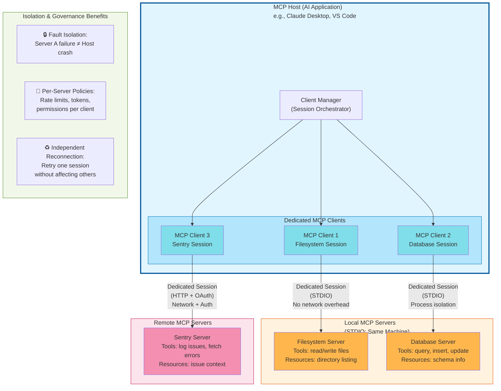
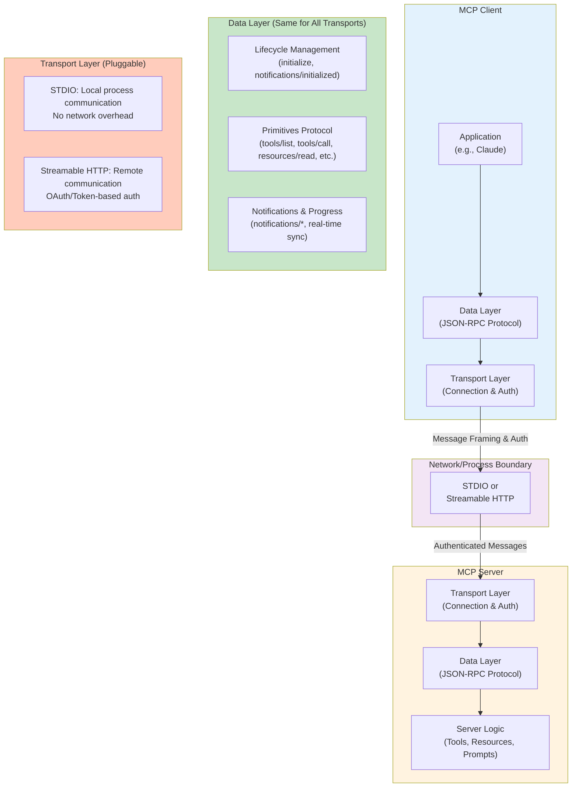
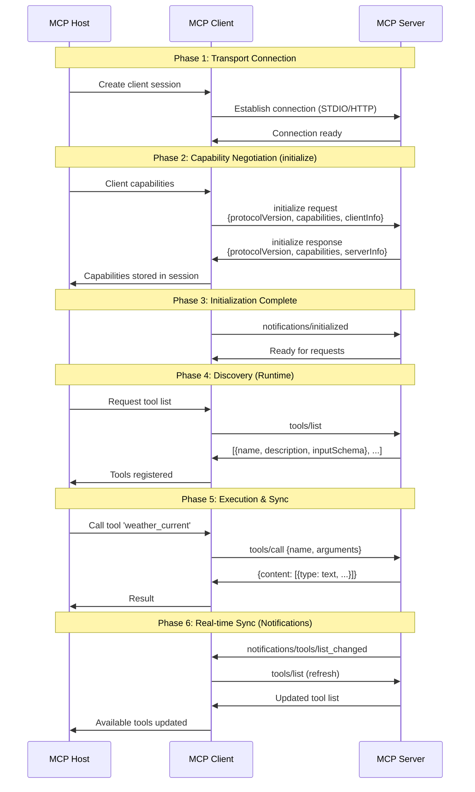
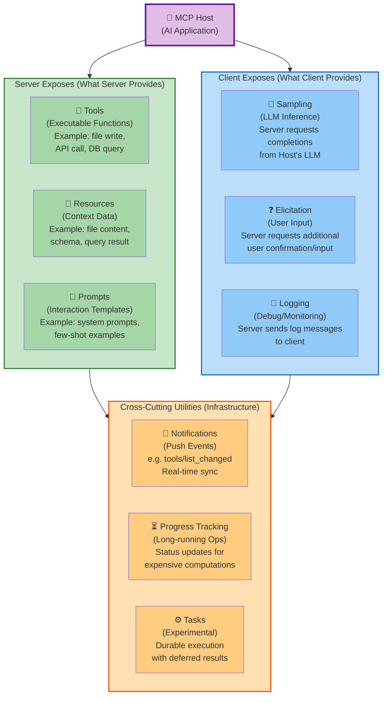
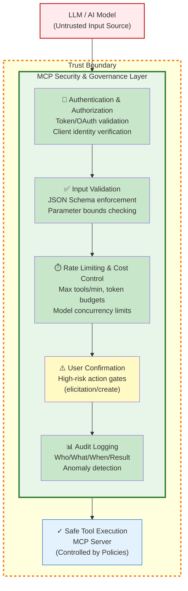

# MCP로 다시 읽는 AI 프레임워크: 결국 우리는 또 아키텍처를 하고 있다

## 도입: 프레임워크는 폭발했고, 본질은 흐려졌다

요즘 AI 생태계는 하루가 다르게 새 이름을 쏟아냅니다. 에이전트 프레임워크, 툴 호출, 멀티모달 오케스트레이션, 추론 체인, 메모리 계층까지. 문제는 기술이 너무 빠르게 늘어나면서, 많은 개발자가 이렇게 느낀다는 점입니다.

- 일단 돌아가게는 만들었는데, 왜 이렇게 구성해야 하는지 설명하기 어렵다
- 프레임워크를 갈아타면 설계가 통째로 흔들린다
- API 사용법은 익혔는데, 시스템 경계와 책임은 더 모호해졌다

이 지점에서 MCP(Model Context Protocol)는 꽤 중요한 신호입니다.  
MCP는 단순히 새로운 AI 기능이 아니라, **AI 애플리케이션이 외부 세계와 상호작용하는 방식을 표준화하려는 아키텍처적 시도**입니다.

핵심 화두는 이것입니다.

> MCP는 “AI가 똑똑해지는 방법”이 아니라 **AI 시스템이 안정적으로 확장되는 방법**에 대한 제안이다.

즉, 이건 모델의 문제가 아니라 **시스템 설계의 문제**입니다. 그리고 이 장면, 백엔드 개발자에게는 아주 익숙합니다.  
새로운 패러다임처럼 보이지만, 실은 우리가 오랫동안 다뤄온 문제의 **재림**입니다.

## 본론 1: MCP 구조를 아키텍처로 해부하기

### MCP의 기본 구도: Host-Client-Server 3계층

공식 문서 관점에서 MCP 참여자는 2개가 아니라 3개입니다.

- **MCP Host**: Claude Desktop, VS Code 같은 AI 애플리케이션
- **MCP Client**: Host 내부에서 서버별로 생성되는 연결 담당 컴포넌트
- **MCP Server**: 컨텍스트(데이터/도구/프롬프트)를 제공하는 프로그램

핵심은 **Host와 Client를 분리해서 이해**하는 것입니다. Host는 오케스트레이션을 담당하고, Client는 특정 서버와의 세션을 전담합니다. 즉, Host 1개가 Server N개와 붙을 때, 내부적으로는 Client N개가 생기는 구조입니다.

#### 1. Host-Client-Server 참여자 다이어그램

**핵심 설계 원칙:**

| 측면 | 설명 |
|------|------|
| **1:N 구조** | Host 1개 → Client N개 → Server N개 (각 세션 독립) |
| **세션 격리** | 한 Server 장애 = 한 Client만 영향 (Host 전체 중단 X) |
| **Transport 다형성** | STDIO(로컬, 빠름) vs HTTP(원격, 인증) 자유 선택 |
| **권한 분리** | 서버별 토큰/인증서/Rate Limit 독립 적용 |
| **재연결 정책** | 개별 세션별 재시도 전략 구사 가능 |

이 구분은 운영에서 매우 중요합니다.

- 서버 장애 격리 단위를 Client 세션 기준으로 분리할 수 있다
- 서버별 권한/토큰/레이트 정책을 독립 적용할 수 있다
- 특정 서버 재연결이 전체 Host 중단으로 번지는 것을 막을 수 있다

중요한 점은, Host가 각 도구의 사소한 차이를 직접 처리하지 않는다는 것입니다.  
Host는 “이런 기능이 필요하다”를 선언하고, Client는 해당 서버와 프로토콜 대화를 수행하며, Server는 정해진 계약으로 응답합니다.

이 구조는 곧 다음 의미를 가집니다.

- 모델 교체와 도구 교체의 결합도를 낮춘다
- 기능 확장을 할 때 Host 코어를 크게 건드리지 않는다
- 운영 정책(권한, 감사, 제한)을 서버 또는 게이트웨이 접점에 집중시킬 수 있다

### MCP는 2개 레이어로 본다: Data Layer + Transport Layer

공식 아키텍처는 MCP를 다음 두 레이어로 설명합니다.

- **Data Layer(내부 레이어)**: JSON-RPC 2.0 메시지 구조/의미, 라이프사이클, 프리미티브
- **Transport Layer(외부 레이어)**: 실제 연결 방식, 메시지 프레이밍, 인증

이걸 백엔드 감각으로 바꾸면 쉽습니다.

- **Data Layer**는 "무슨 API를 어떤 의미로 주고받는가"에 대한 계약
- **Transport Layer**는 "그 API를 어떤 채널로 안전하게 전달하는가"에 대한 인프라

즉, REST API 설계에서 "리소스 모델"과 "네트워크 경로/인증"를 분리하듯, MCP도 의미 계층과 전달 계층을 분리합니다.

#### 2. Data Layer vs Transport Layer 구조

**주요 통찰:**

- **Data Layer는 불변**: STDIO든 HTTP든 JSON-RPC 2.0 메시지 포맷은 동일
- **Transport Layer는 교체 가능**: "USB-C 포트" 같이 프로토콜 의미는 유지되고 물리 채널만 바뀜
- **보안은 Transport에 속함**: 인증, 토큰, Rate Limiting은 모두 Transport Layer의 책임

### 화려한 AI가 아니라, 사실은 Json-RPC 계약

많은 사람이 MCP를 들으면 복잡한 AI 런타임을 먼저 떠올립니다. 하지만 기술적 본체는 의외로 담백합니다.

- 요청/응답 기반의 명시적 인터페이스
- 메서드, 파라미터, 결과, 에러 구조의 규격화
- 상태 전이와 예외를 메시지 프로토콜로 표현

즉, MCP는 본질적으로 **JSON-RPC 2.0 기반의 표준 통신 계약**입니다. 이 말은 곧 진입장벽을 크게 낮춥니다.

- “AI 전용 마법”이 아니라 우리가 익숙한 네트워크 프로토콜 설계 문제다
- 잘 정의된 스키마, 타임아웃, 재시도, 에러 코드가 품질을 좌우한다
- 결국 운영 가능한 인터페이스를 설계하는 역량이 핵심이다

#### 3. 라이프사이클 (Lifecycle) 초기화 및 동작 흐름

공식 문서는 다음 5단계 플로우를 정석으로 제시합니다.

**흐름의 본질:**

1. **Transport 계층**: 채널 연결 수립 (STDIO 파이프 또는 HTTP 세션)
2. **Capability 협상**: `initialize`로 양쪽의 지원 Primitive 선언 → 공격면 축소
3. **Discovery**: Runtime으로 도구/리소스 목록 조회 (컴파일 타임이 아님)
4. **Execution**: 스키마 기반 호출로 타입 안전성 확보
5. **Notification**: 서버 상태 변화를 푸시로 동기화 (폴링 X)

이는 결국 API 부트스트랩과 동일합니다. **초기 핸드셰이크로 합의하고, Capability 기반으로 안전하게 기능을 호출하며, Notification으로 캐시를 동기화**합니다.

### MCP Architecture에서 반드시 알아야 할 Primitive 전체 지도

공식 문서에서 가장 중요한 파트는 프리미티브(Primitives)입니다. "무엇을 주고받을 수 있는가"를 정의하기 때문입니다.

공식 문서에서 가장 중요한 파트는 프리미티브(Primitives)입니다. "무엇을 주고받을 수 있는가"를 정의하기 때문입니다.

#### 5. MCP Primitives 전체 맵핑: 서버/클라이언트/유틸리티

**서버가 제공하는 3대 Primitive**

- **Tools** (행동): 실행 가능한 함수. 예: 파일 수정, API 호출, DB 질의. Discovery: `tools/list`, 실행: `tools/call`
- **Resources** (맥락): 읽기 중심 컨텍스트. 예: 파일 내용, 스키마, 조회 결과. Discovery: `resources/list`, 조회: `resources/read`
- **Prompts** (전략): 재사용 가능한 상호작용 템플릿. Discovery: `prompts/list`, 조회: `prompts/get`

**클라이언트가 제공하는 Primitive (역방향)**

- **Sampling**: 서버가 Host의 LLM 추론을 요청 (`sampling/createMessage`). 모델 독립적 서버 구성 가능
- **Elicitation**: 서버가 사용자 추가 입력/확인을 요청 (`elicitation/create`). 민감 액션 가이트
- **Logging**: 서버가 클라이언트로 디버깅/모니터링 로그 전송

**크로스커팅 유틸리티**

- **Notifications**: 무응답 이벤트 푸시 (예: `notifications/tools/list_changed`). 폴링 없는 실시간 동기화
- **Progress Tracking**: 장시간 작업 진행상태 추적. 대화 블로킹 방지
- **Tasks(Experimental)**: 지연 완료/상태 조회가 필요한 Durable 실행 래퍼

**핵심 설계 통찰:**

| 개념 | 의미 | 실무 적용 |
|------|------|----------|
| **Tools** | "행동" | LLM이 외부에 영향을 주는 점 (마우스/키보드처럼) |
| **Resources** | "맥락" | LLM이 읽을 배경 지식 (문서, 스키마 같이) |
| **Prompts** | "전략" | 상호작용 재사용 패턴 (시스템 프롬프트 같이) |
| **Discovery** | "런타임 협상" | 컴파일 타임이 아닌 세션 시작 시 Capability 물어보기 |
| **Notifications** | "캐시 동기화" | 서버 변화 시 폴링 없이 클라이언트 자동 갱신 |

### 전송(Transport) 기술의 본질: STDIO vs Streamable HTTP

MCP 공식 문서는 두 가지 전송 방식을 중심으로 설명합니다.

- **STDIO Transport**: 로컬 프로세스 간 표준 입출력 통신
- **Streamable HTTP Transport**: 원격 통신(POST 기반, 필요 시 SSE 스트리밍)

실무에서의 선택 기준은 명확합니다.

- 로컬 IDE 플러그인/에이전트 확장: STDIO가 단순하고 빠르다
- 팀 공유 도구/사내 플랫폼 연동: Streamable HTTP가 운영과 확장에 유리하다

원격 환경에서는 인증이 핵심이며, 공식 문서도 표준 HTTP 인증(토큰/키/헤더)과 OAuth 기반 토큰 획득을 권장합니다.

여기서 기술의 본질은 "LLM 연결"이 아니라 **신뢰 경계(Trust Boundary) 설계**입니다. 로컬 서버는 OS 권한 경계에, 원격 서버는 네트워크/인증 경계에 서 있습니다.

요약하면, MCP의 첫인상은 AI지만 실제 난이도 곡선은 **분산 시스템 인터페이스 설계**에 가깝습니다.

---

## 본론 2: 아키텍처 관점에서 본 AI 프레임워크의 기술적 본질

이제 핵심입니다. MCP를 통해 보이는 AI 프레임워크의 본질은 크게 세 축으로 정리됩니다.

## 1) 프로토콜 표준화: 파편화를 추상화 계층으로 흡수한다

AI 앱이 연결해야 할 대상은 제각각입니다.

- SaaS API는 인증 방식이 다르고
- 사내 시스템은 포맷과 제약이 다르며
- 데이터 소스는 지연시간과 장애 패턴이 다릅니다

프레임워크를 직접 붙일수록 Host는 조건문과 예외처리로 비대해집니다. MCP는 이 문제를 **프로토콜 표준화 계층**으로 해결합니다.

### 백엔드 비유 1: JDBC 드라이버 모델

JDBC가 없던 시절을 상상해보면, 애플리케이션은 DB 벤더별 API를 직접 알았어야 합니다.  
JDBC가 등장하면서 우리는 “Driver를 갈아 끼워도 애플리케이션 코어는 유지”할 수 있게 됐습니다.

MCP도 동일한 철학입니다.

- Host는 MCP 계약만 안다
- 실제 구현 차이는 Server가 흡수한다
- 신규 도구 추가는 Host 수정이 아닌 Server 등록으로 수렴한다

공식 Architecture 관점에서 보면 이 표준화는 더 정밀합니다.

- `*/list`로 동적 Discovery를 수행한다
- Discovery 결과의 메타데이터(`name`, `description`, `inputSchema`)를 계약으로 쓴다
- 호출은 계약 기반(`tools/call`)으로만 진행한다

즉, 컴파일 타임 결합이 아니라 **런타임 Capability 협상 + 스키마 기반 호출**로 파편화를 흡수합니다.

여기서 자연스럽게 **OCP(개방-폐쇄 원칙)** 가 살아납니다.

- 확장에는 열려 있고
- 핵심 로직 수정에는 닫혀 있는 구조

AI 프레임워크의 경쟁력은 모델 성능 이전에, 이런 **변화 내성(Resilience to Change)** 을 얼마나 잘 설계했느냐에서 갈립니다.

---

## 2) 보안 및 권한 제어: MCP는 도구 호출의 관문이 된다

LLM 기반 시스템의 보안 이슈는 더 이상 이론이 아닙니다. 대표적인 위험은 다음과 같습니다.

- 프롬프트 주입으로 의도치 않은 도구 실행 유도
- 과권한 도구 호출로 민감 데이터 접근
- 대량 호출로 비용 폭증 또는 장애 유발

이때 MCP 계층은 단순 라우팅이 아니라 **거버넌스 게이트웨이**가 됩니다.

### 백엔드 비유 2: API Gateway + 정책 엔진

우리가 API Gateway에서 하던 일이 그대로 필요합니다.

- **인증/인가**: 누가 어떤 도구를, 어떤 범위로 호출 가능한가
- **입력 유효성 검증**: 파라미터 스키마와 허용 값 검사
- **Rate Limiting**: 모델 폭주나 악성 요청 억제
- **감사 로그**: 누가 언제 무엇을 호출했고, 결과가 어땠는가
- **정책 기반 차단**: 민감 액션에 대한 조건부 승인

여기에 MCP 공식 개념을 결합하면, 보안 레이어는 다음처럼 더 분명해집니다.

- **초기화 단계(Initialize)**: 지원 Capability만 노출해 공격면 축소
- **도구 스키마 검증**: `inputSchema`로 타입/범위 검증 강제
- **사용자 확인 루프**: `elicitation/create`를 통한 고위험 액션 확인
- **실시간 가시성**: Logging/Notifications로 이상 징후 조기 탐지

#### 4. MCP 보안 계층: API Gateway 패턴 적용

**보안의 핵심 아키텍처:**

프롬프트 = **신뢰 경계 밖의 입력**이므로, 도구 호출은 항상 다층 검증을 거쳐야 합니다.

| 레이어 | 역할 | MCP 개념 맵핑 |
|--------|------|--------------|
| 1. 인증 | 호출자 정체 확인 | Transport Layer Auth (OAuth/Bearer Token) |
| 2. 검증 | 입력값이 계약 만족 | `initialize` + `inputSchema` 검증 |
| 3. 제한 | 과도한 호출 차단 | Rate Limiting (클라이언트 레벨) |
| 4. 확인 | 민감 액션 재확인 | `elicitation/create` (사용자 개입) |
| 5. 감시 | 실행 흔적 기록 | `logging` + `notifications` 활용 |

핵심 인식 전환은 이것입니다.

> 프롬프트는 신뢰 경계 밖의 입력이다.  
> 
> 따라서 도구 실행은 항상 검증된 인터페이스를 통해서만 허용되어야 한다.

즉, “모델이 시키니까 실행”이 아니라 “정책이 허용한 실행만 통과”시키는 구조가 필요합니다. MCP를 제대로 쓴다는 말은 결국 **보안 정책을 실행 경로에 내재화**한다는 뜻입니다.

한 줄로 말하면, MCP의 보안은 "모델의 선의"가 아니라 **프로토콜의 제약**으로 달성해야 합니다.

---

## 3) 컨텍스트 최적화: 필요한 순간에, 필요한 만큼만 가져온다

LLM 시스템의 비용과 성능은 결국 컨텍스트 관리에서 무너집니다.

- 무작정 많이 넣으면 토큰 비용이 폭증하고 지연이 커진다
- 너무 적게 넣으면 정확도가 떨어진다
- 항상 최신이 필요한 데이터는 프롬프트에 고정 저장할 수 없다

MCP는 여기에 대해 **온디맨드 페칭(On-Demand Fetching)** 전략을 가능하게 합니다.

### 백엔드 비유 3: 지연 로딩, 페이징, 캐싱

이건 사실 우리가 이미 잘 아는 패턴의 AI 버전입니다.

- **지연 로딩**: 정말 필요해진 시점에만 외부 데이터 조회
- **페이징**: 한 번에 모든 문서를 넣지 않고 단계적으로 확장
- **캐싱**: 변동성이 낮은 정보는 재사용해 비용 절감
- **TTL 기반 재검증**: 오래된 컨텍스트는 만료 후 갱신

공식 프로토콜의 Discovery/Notification 메커니즘을 붙이면 최적화가 더 현실적이 됩니다.

- 초기에 모든 데이터를 밀어 넣지 않고 `resources/list` 후 `resources/read`를 지연 호출
- 도구/리소스 목록 변경 시 Notification 기반으로 캐시만 갱신
- 장시간 연산은 Progress/Tasks로 분리해 대화 지연을 줄임

좋은 AI 시스템은 “많이 아는 시스템”이 아니라 **질문 맥락에 맞춰 정확히 조달하는 시스템**입니다.

이 관점에서 MCP는 RAG를 포함한 컨텍스트 전략 전반을 “프롬프트 엔지니어링”의 영역에서 “아키텍처 설계”의 영역으로 끌어올립니다.

그리고 여기서 백엔드 개발자의 장점이 극대화됩니다.

- 어떤 데이터를 선조회할지, 무엇을 지연조회할지 결정하는 캐시 전략
- 스키마 진화와 하위 호환성을 고려한 계약 설계
- 비용/지연/정확도의 SLO를 운영 지표로 관리하는 플랫폼 감각

---

## 정리: MCP는 새로운 기술이 아니라, 오래된 원칙의 귀환이다

MCP를 보면 결국 한 문장으로 수렴합니다.

- 표준화로 결합도를 낮추고
- 거버넌스로 실행을 통제하며
- 온디맨드 최적화로 비용과 성능을 균형 잡는다

이건 낯선 AI 마법이 아니라, 우리가 백엔드에서 반복 학습해온 아키텍처 원칙의 재등장입니다.

그래서 지금 필요한 역할은 단순한 프레임워크 소비자가 아닙니다. 필요한 사람은 **AI-Native 아키텍트**입니다.

- 모델을 바꿔도 시스템이 버티게 설계하는 사람
- 도구를 붙일수록 통제가 강화되게 만드는 사람
- 비용, 지연, 정확도의 트레이드오프를 운영 가능한 정책으로 바꾸는 사람

---

## 실전 Action Item: 오늘부터 아키텍트 관점으로 전환하기

### 오늘 당장 할 일

1. **MCP 공식 Intro/Architecture 문서를 정독하고, Host-Client-Server를 직접 도식화해보기**
2. **JSON-RPC 2.0 요청/응답/Notification 형식을 팀 위키에 템플릿으로 정리해보기**
3. 현재 팀 서비스에서 “도구 호출”에 해당하는 지점을 3개만 식별해보기
4. 각 지점에 대해 입력 스키마, 에러 코드, 타임아웃 정책을 문서로 적어보기

### 이번 주 내로 할 일

1. 레거시 기능 하나를 골라 **MCP 스타일 스키마로 추상화**해보기
2. 호출 경로에 인증/인가, 유효성 검증, 호출 제한 정책을 체크리스트로 삽입해보기
3. `tools/list`-`tools/call`-`notifications/tools/list_changed` 흐름을 로컬 PoC로 구현해보기
4. 컨텍스트 로딩을 즉시 로딩에서 온디맨드 방식으로 바꿨을 때의 비용 차이를 측정해보기

### 이번 달에 도전할 일

1. 사내 공통 MCP Server PoC를 만들어 팀별 도구를 표준 계약으로 노출해보기
2. 감사 로그와 보안 정책을 결합한 최소 거버넌스 대시보드를 설계해보기
3. STDIO 기반 로컬 서버와 Streamable HTTP 기반 원격 서버를 각각 붙여 운영성 차이를 비교해보기
4. 모델 교체 실험을 통해 “모델 독립적 아키텍처” 수준을 점검해보기

## 참고한 MCP 공식 문서

- https://modelcontextprotocol.io/docs/getting-started/intro
- https://modelcontextprotocol.io/docs/learn/architecture
